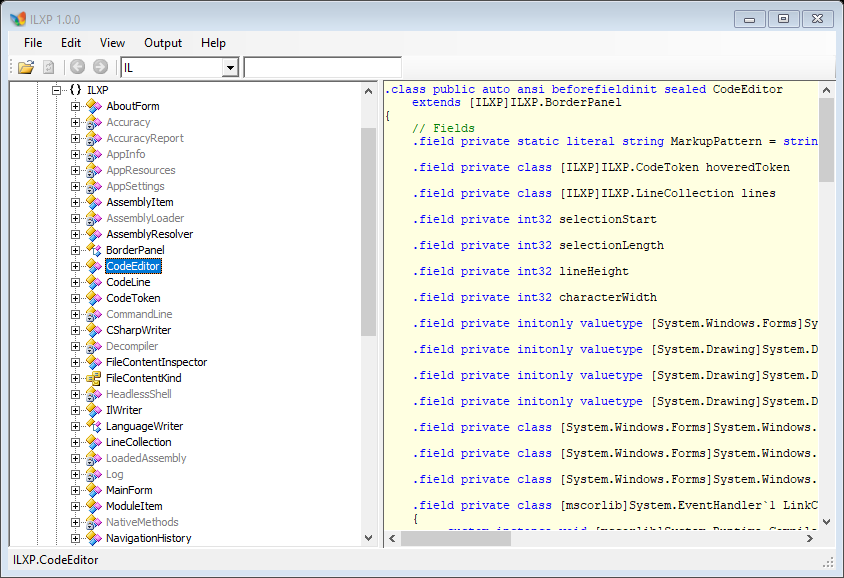

# ILXP



ILXP is a preserved and restored .NET decompiler / IL analysis tool. It started life as a
decompiled copy of the old **CodeReflect** decompiler (DevExtras) and is being rebuilt into a
maintainable, deobfuscated application with additional functionality merged from other open
tools (ILSpy, dnSpy, de4dot and the Unscrambler feature set).

The screenshot above is ILXP decompiling **itself**: the tree shows the real types of
`ILXP.exe`, and the right pane shows the IL view of `ILXP.CodeEditor`.

The project is deliberately conservative:

* **.NET Framework 4.0**, x86 and x64 (Windows XP compatible).
* No external runtime dependencies at startup; everything needed is either source in this
  repository or shipped in `native/`.
* All third-party libraries are embedded as source and built from this solution.
* Every failure path is logged through `System.Diagnostics.Trace` and degrades gracefully.

## Building

Requirements: .NET SDK (tested with 9.x) and the .NET Framework 4.0 reference assemblies
(installed with Visual Studio or the Windows SDK).

```powershell
# Any CPU (default solution configuration)
dotnet build ILXP.slnx

# x86 / x64 (the .slnx only declares "Any CPU", so target the project directly)
dotnet build src\ILXP\ILXP.csproj -c Release -p:Platform=x86
dotnet build src\ILXP\ILXP.csproj -c Release -p:Platform=x64
```

Output:

* `src/ILXP/bin/Debug/net40/ILXP.exe` – AnyCPU application
* `src/ILXP/bin/x86/Debug/net40/ILXP.exe` – x86 build
* `src/ILXP/bin/x64/Debug/net40/ILXP.exe` – x64 build

The build produces a **single executable**: Mono.Cecil is compiled into `ILXP.exe`, and the
`native/` folder is no longer shipped (all native tools have managed replacements).

## Running

Start the GUI:

```powershell
src\ILXP\bin\Debug\net40\ILXP.exe
```

Command line mode (all commands are logged to `%APPDATA%\ILXP\logs\ILXP.log`):

```text
ILXP --version
ILXP --list <assembly>
ILXP --tree <assembly> [--deep]
ILXP --decompile <assembly> [--language il|cs|vb] [--dialect <id>] [--bodies] [--output <dir>]
ILXP --resources <assembly> --output <dir>
ILXP --ildasm <assembly> [--output <file.il>] [--bytes] [--native]
ILXP --ilasm <file.il> [--output <assembly>] [--dll] [--x86|--x64] [--native]
ILXP --disasm-x86 <file> [--offset <n>] [--length <n>] [--x64]
ILXP --clean <assembly> [--output <assembly>]
ILXP --music <file.mid|file.txt> [--output <out.mid|out.txt|out.wav>]
ILXP --verify <assembly>
ILXP --search <assembly> <query>
ILXP --expand <assembly> [--depth <n>]
ILXP --ilmap <assembly> <type> <method>
ILXP --ilsearch <assembly> <pattern> [--literal] [--max <n>]
ILXP --health <assembly>
ILXP --diff <left> <right>
ILXP --bundle <assembly> --output <dir>
ILXP --fixpoint <assembly> [--iterations <n>]
ILXP --callgraph <assembly> [--max <n>]
ILXP --ilverify <assembly> [--max <n>]
ILXP --bodydiff <left> <right> [--match <text>] [--max <n>]
ILXP --screenshot <out.png> [--window about|main|quickopen] [--open <assembly>] [--select <type>] [--query <text>]
ILXP --render-water <out.png> [--width <n>] [--height <n>] [--frames <n>]
```

Output dialects (`--dialect`): `cs1` C# 1.0 / VS 2002, `cs2` C# 2.0 / VS 2005, `cs3` C# 3.0,
`cs4` C# 4.0, `cs5` C# 5.0, `cs6` C# 6.0, `cs7` C# 7.3, `cs8` C# 8.0, `cs9` C# 9.0+,
`sd` SharpDevelop 1.x–5.x, `vb` Visual Basic.

Notes:

* `--decompile` writes one file per type using the selected writer. IL output contains method
  bodies; the C#/VB type view is an outline and `--bodies` appends the method bodies.
* `--ildasm`, `--ilasm` and `--disasm-x86` use the **managed** implementations by default;
  pass `--native` to use `native/ildasm.exe`, `native/ilasm.exe` or `native/BeaEngine.dll`.
* `--clean` applies the IL cleanup passes from `src/ILXP/Deobfuscation` and writes a new
  assembly. Strong-name signatures are not preserved.
* `--music` converts between `.mid` and the text format, and renders `.wav` with the built-in
  chiptune synthesizer.
* `--screenshot --open <assembly> --select <type>` loads an assembly and selects a type before
  capturing, which is how `docs/screenshot-main.png` is produced.
* `--search` uses the same fuzzy index as the Ctrl+P palette, so it doubles as a test hook.
* `--ilmap` prints the line → IL offset map of one method (the same map the editor uses for
  `Ctrl+G`) and verifies the reverse lookup.
* `--ilsearch` is the engine behind `Ctrl+Shift+F`: a regex over the rendered IL of every
  method, reporting the type, method, IL offset and the matching line.

## Search

* `Ctrl+P` — **Quick Open**: fuzzy search over every type and member of the loaded assemblies.
* `Ctrl+Shift+F` — **Search in IL**: regex (or literal) search over the rendered IL of every
  method. Results show type, method, `IL_xxxx` offset and the matching line; double-click
  jumps to the method and selects the instruction.
* `Ctrl+F` — tree filter.
* **Edit → Copy as…** copies the full name, signature, IL, C# or VB of the selected node, the
  assembly reference list, the target framework, or the navigation key.

## IL ⇄ source navigation

Every instruction in the IL view is labelled (`L_0000:`, `L_0001:`, …) and those labels are
clickable links. `IlLineMap` recovers the line → offset map from the rendered text itself, so:

* clicking a line and reading the status bar shows `IL_00xx (line N)`;
* `Ctrl+G` (or *Edit → Go to IL offset…*) accepts `0x002a`, `002ah` or `002a` and selects the
  instruction at — or the closest one before — that offset.

## Keyboard shortcuts

| Shortcut | Action |
| --- | --- |
| `Ctrl+P` | Quick Open (fuzzy search over all types and members) |
| `Ctrl+Shift+F` | search in IL (regex over every method, with offsets) |
| `Ctrl+G` | go to an IL offset in the current method view |
| `Ctrl+E` | Expand the tree to a chosen depth (0–9 or everything) |
| `Ctrl+F` | focus the tree search box (`Enter` = next match, `Esc` = clear) |
| `Ctrl+O` | open an assembly |
| `Ctrl+Shift+C` | copy the selected node name |
| `F5` | refresh all assemblies |
| `Alt+Left` / `Alt+Right` | navigation history |

## Testing

```powershell
# full test suite (40 checks: CLI, accuracy, round trip, obfuscation, music, headless)
dotnet build ILXP.slnx
tests\ILXP.Tests\bin\Debug\net40\ILXP.Tests.exe run

# quick CLI smoke test
powershell -File tools\Smoke-Test.ps1

# structural completeness of the decompiler, measured on ILXP.exe itself
src\ILXP\bin\Debug\net40\ILXP.exe --accuracy src\ILXP\bin\Debug\net40\ILXP.exe --language il
src\ILXP\bin\Debug\net40\ILXP.exe --accuracy src\ILXP\bin\Debug\net40\ILXP.exe --language cs
src\ILXP\bin\Debug\net40\ILXP.exe --accuracy src\ILXP\bin\Debug\net40\ILXP.exe --language vb

# obfuscate an assembly with the built-in test obfuscator, then decompile it
tests\ILXP.Tests\bin\Debug\net40\ILXP.Tests.exe obfuscate ILXP.exe ILXP.obf.exe 1234
src\ILXP\bin\Debug\net40\ILXP.exe --verify ILXP.obf.exe
src\ILXP\bin\Debug\net40\ILXP.exe --clean ILXP.obf.exe --output ILXP.clean.exe

# headless command shell (scriptable, no window)
"open ILXP.exe`naccuracy cs`nquit" | src\ILXP\bin\Debug\net40\ILXP.exe --headless
```

Current measured accuracy on `ILXP.exe` (5 000+ metadata members):

| writer | structural completeness |
| --- | --- |
| IL | 100.0 % |
| C# | 99.9 % |
| VB | 99.6 % |

`--accuracy` reports per-member coverage (types, methods, fields, properties, events) and can
list the missing members with `--verbose`. `--verify` checks every instruction operand and
branch target, which is also what the cleanup passes are validated against.

## Settings

`View → Settings…` opens a category-based settings dialog (the same layout idea as ILSpy and
dnSpy): **General**, **Tree**, **Output**, **Music**, **Advanced**. Values are stored in
`%APPDATA%\ILXP\settings.ini` and applied immediately on OK. "Reset to defaults" clears every
stored key.

Notable options:

* **Tree → Default expand depth (0–9)** – used by *View → Expand to depth…* (`Ctrl+E`).
* **Tree → Lazy references** – resolve referenced assemblies only when a reference is opened.
* **Output → Default language / Output dialect** – the writer and target toolchain.
* **Music → Play music in the About box / Default tune / Volume**.

Tree expansion is deliberately conservative: *Expand all* walks the tree level by level with a
25 000 node budget, pumps the message queue between levels and reports progress in the status
bar, so it can never freeze the UI the way `TreeView.ExpandAll()` would on a lazy tree.
Reference nodes are skipped by bulk expansion (resolving every dependency from disk is the main
cause of multi-minute freezes); open them individually when you need them.

Measured on `ILXP.exe`: depth 3 → 608 nodes / 1.4 s, "everything" → 10 201 nodes / 3.4 s.

## Analysis tools

* **Assembly health** (`Edit → Assembly health…`, `--health`) — PE facts (machine, sections with
  entropy, deterministic-build marker, CLR header, CorFlags, strong name), metadata counts,
  resolution of every reference, a 0–100 health score and a list of findings.
* **Obfuscator fingerprint** (part of the health report) — scored signatures for Confuser /
  ConfuserEx, .NET Reactor, Eazfuscator, SmartAssembly, Dotfuscator, Babel, Crypto Obfuscator,
  Agile.NET, Xenocode, ILProtector, MaxtoCode, Goliath, Skater, CodeWall, Spices.NET, MPRESS,
  UPX, Themida, plus generic indicators (name readability, section entropy, NOP density,
  base64 literals, proxy methods). Measured: clean build 8/100, obfuscated 56/100.
* **Version diff** (`File → Compare versions…`, `--diff`) — matches members by identity and
  compares IL hashes, so offsets and branch targets do not create false positives. Reports
  added / removed / changed with `body added`, `body removed`, `body differs`.
* **Preservation bundle** (`File → Export preservation bundle…`, `--bundle`) — one folder with
  the original bytes and PDB, the IL listing, decompiled IL/C#/VB, every embedded resource,
  the health report and a `manifest.txt` with a SHA-256 for each file.
* **Call graph** (`Edit → Call graph…`, `--callgraph`) — fan-out, fan-in, methods with no
  internal caller, recursion cycles (iterative Tarjan) and the number of external calls.
* **Fixpoint test** (`--fixpoint`) — decompiles to IL, reassembles with the managed assembler
  and diffs the result against the original, including the exception-handler tables. Every body
  is also run through the structural verifier (stack depth, `maxstack`, branch ranges, handler
  boundaries), so a body that is textually identical but invalid for the CLR is reported:
  **100 %** member fidelity, **100 %** body fidelity (4077 of 4077 bodies) and *0 invalid
  bodies before and after* the round trip on `ILXP.exe`; on `System.Core.dll` 100 % member
  fidelity and 99.30 % body fidelity (55 of 7852 bodies differ - `--bodydiff` names the exact
  instruction where each one diverges).
* **IL verifier** (`--ilverify`) - simulates the evaluation stack through every method body and
  reports stack underflow/overflow against `.maxstack`, a non-empty stack at `ret`, out-of-range
  or backwards branch/handler boundaries, invalid filter placement and impossible local/argument
  indices. Calibrated on real framework assemblies: **no findings** on `mscorlib.dll`
  (25 337 bodies), `System.dll` (16 389), `System.Core.dll` (7 852) and `System.Xml.dll`
  (12 251), none on `ILXP.exe`, while a deliberately broken body is reported by method name.
* **Body diff** (`--bodydiff <left> <right> [--match <text>]`) - for every changed body, prints
  the first position where the two hashed instruction streams diverge, with context; turns
  "body differs" into something actionable.
* **Round-trip capable IL assembler** — `.property` / `.event` directives, `.try` / `catch` /
  `finally` / `filter` / `fault` handler tables, `.override` (explicit interface
  implementations), nested types (including generic ones such as `Collection<T>.Enumerator`),
  `implements` lists, generic types and generic methods (with `!N` / `!!N`, generic arguments
  and `.genericparams` names), P/Invoke declarations, static field data (`.data … at I_xxxx`),
  entry point, assembly scopes (`[System.Core]`), `[.module]` for forward references and public
  key tokens. Types are pre-declared before any body is parsed, so a body may reference a type
  that appears later in the listing; local names carry their slot index, because compilers
  reuse names such as `value` for temporaries and a name-based reference would bind to the
  wrong slot.
  A small program with lambdas, LINQ, generic delegates, `switch`, `foreach` over
  `List<T>` and `try/catch/finally` round-trips into a working executable — and so does ILXP
  itself: `--ildasm ILXP.exe` → `--ilasm` produces an `ilxp.exe` that starts the GUI and
  decompiles other assemblies at 100 % accuracy. `PEVerify` reports the same 4 findings for
  the rebuilt image as for the original (unmanaged pointer code in `WaterLogo`), i.e. the
  round trip is now metadata-clean.

## Repository layout

```text
ILXP.slnx                     solution
ILXP.ico                      application icon (from refs/239.ico)
src/ILXP/                     application source
  AppInfo.cs, AppSettings.cs, Log.cs, Program.cs, OutputDialect.cs
  AssemblyItem.cs, ModuleItem.cs, AssemblyResolver.cs, AssemblyLoader.cs
  LanguageWriter.cs, CSharpWriter.cs, IlWriter.cs, VbWriter.cs
  StatementDecompiler.cs      IL -> C#/VB statement translator
  FileContentInspector.cs     resource classification / hex dump / .resources view
  Accuracy.cs, Decompiler.cs  export helpers and structural completeness metrics
  HeadlessShell.cs            scriptable command shell (--headless)
  MainForm.cs, MainForm.Designer.cs, MainForm.Tree.cs, AboutForm.cs
  CodeEditor.cs, BorderPanel.cs, UiThread.cs, CodeLine.cs, CodeToken.cs ...
  Deobfuscation/              IL cleanup passes (ported from Unscrambler)
  Interop/                    managed ILDasm/ILAsm/disassembler + native fallbacks
  Music/                      MIDI I/O, GM instrument map, synthesizer, player
  UI/                         WaterLogo (interactive water surface)
  Resources/                  embedded images and tree icon payload
src/Cecil/                    Mono.Cecil 0.9.6.4, decompiled and embedded as source
src/Cecil.Pdb/                Mono.Cecil.Pdb, decompiled and embedded as source
tests/ILXP.Tests/             test runner + from-scratch test obfuscator
native/                       original native tools, reference only (not shipped)
tools/                        maintenance and test scripts
docs/                         screenshots used by this README
refs/                         reference material (git-ignored)
```

## Managed replacements for the native tools

The `native/` binaries are no longer required at runtime:

| Native tool | Managed replacement |
| --- | --- |
| `ildasm.exe` | `Interop/ManagedIlDisassembler.cs` (Cecil → ILAsm text) |
| `ilasm.exe` | `Interop/ManagedIlAssembler.cs` (ILAsm text → Cecil → PE) |
| `BeaEngine.dll` | `Interop/ManagedDisassembler.cs` (x86/x64 length decoder + formatter) |
| `fusion.dll` | `AssemblyResolver.cs` (GAC probing in managed code) |

Pass `--native` to use the shipped executables/DLL instead. See
[REVERSE_ENGINEERING.md](REVERSE_ENGINEERING.md) for the analysis behind each one.

## Music player

The About box contains a small player:

* Tunes are stored in the text MIDI format (`Music/Tracks/*.txt`, embedded) and parsed by
  `MidiTextFormat`. `MidiReader`/`MidiWriter` convert real `.mid` files both ways.
* `InstrumentMap` describes the full General MIDI program set (all 128 programs, grouped into
  piano / chromatic / organ / guitar / bass / strings / ensemble / brass / reed / pipe /
  synth lead / synth pad / FX / ethnic / percussive / sound effects) plus the complete
  percussion map (35–81), each with its own oscillator mix, ADSR, filter and modulation.
* `Synthesizer` renders the sequence with pulse/triangle/saw/sine/noise oscillators, a resonant
  state-variable low-pass filter with envelope, vibrato, detune, PWM, per-channel
  volume/expression/pan and sustain-pedal handling. Rendering is streamed to a WAV file and
  cached by content hash, so the second play of a tune is instant.
* `MusicPlayer` renders on a worker thread and loops through `System.Media.SoundPlayer`.
* The player starts when the About box opens, stops when it closes, and "Another music..."
  offers the built-in tunes plus MIDI/TXT import and MIDI export.

The logo is a `WaterLogo` control: an interactive height-field water surface. Clicking or
dragging distorts the image and produces visible blue ripples; ambient drops keep it alive.

## Status

See [PROJECT_STATE.md](PROJECT_STATE.md) for the current state and [ROADMAP.md](ROADMAP.md)
for the plan. The short version: the application builds, starts, loads assemblies, renders
IL/C#/VB, extracts resources, can call ILDasm/ILAsm, and has a working CLI. The remaining
large work items are the full merge of de4dot/dnSpy functionality and a complete rename of
the remaining obfuscated member names inside `StatementDecompiler`.

## Documentation

* [ARCHITECTURE.md](ARCHITECTURE.md) – how the decompiler and UI fit together
* [ROADMAP.md](ROADMAP.md) – planned work
* [IDEAS.md](IDEAS.md) – feature backlog (music, tree, dialects, compatibility)
* [REVERSE_ENGINEERING.md](REVERSE_ENGINEERING.md) – findings for the shipped native tools
* [PROJECT_STATE.md](PROJECT_STATE.md) – state, conventions, next steps
* [PROMPT.md](PROMPT.md) – original task statement and rules
